# Agent Auditor

**An internal control for a company's AI agent: hard rules before it pays, and an independent check of every payment after.**

Built for the UBC 2026 Hackathon (Agentic Payments & AI track, Best use of Solana, QuickNode Streams bounty).

## The problem

AI agents can now spend money on their own. A company that gives its agent a wallet usually gets spending limits or a payment log. Nobody independently checks two things for each payment:

1. **Was this a payment the agent meant to make?** A stolen key, or an agent tricked by a prompt injection, can send money that no one approved.
2. **Did the agent get what it paid for?** A seller can take the money and deliver nothing, or the wrong thing.

Agent Auditor is the control on the agent, the way a finance team checks an employee who has a company credit card.

## How it works

**The agent never holds the key.** The buyer agent asks a gateway to buy something. Only the gateway holds the wallet's private key, and it pays only orders that pass the rules.

**Preventive controls (before anything is signed).** The gateway checks hard yes/no rules from `config/rules.json`:
- The seller must be approved.
- The order must be within the per-purchase limit ($1.00) and the daily limit ($5.00).
- The seller's quote can't exceed the order's maximum, and must pay the seller's known wallet, in USDC on Solana devnet.

Anything not explicitly allowed is denied. Orders over $0.50 wait for a human to approve them.

**Detective controls (after the payment).** Every payment that leaves the wallet is read from the chain, including payments that never went through the gateway:
1. Each payment is matched to its order by the `order_id` the gateway put in the transaction memo.
2. The delivery is checked: something arrived, in the right format, matching what was ordered.
3. A clean purchase is booked as a journal entry: debit `Data purchases expense`, credit `USDC - agent wallet`.
4. Anything else becomes an exception for a human, who can approve it or block the seller. Examples: a payment with no matching order (a stolen key), the wrong wallet or amount, or a bad delivery.

All money is handled as integers in USDC base units (1 USDC = 1,000,000), never as decimals.

## Architecture

```mermaid
flowchart LR
    Agent["Buyer agent<br/>(Claude, lib/buyer-agent.ts)"]
    Gateway["Gateway<br/>POST /api/orders<br/>rules + x402 payment"]
    PayAI["PayAI<br/>x402 facilitator"]
    Seller["Seller<br/>/api/sellers/[seller]"]
    Chain[("Solana devnet<br/>USDC transfer,<br/>memo = order_id")]
    Streams["QuickNode Streams"]
    Webhook["Webhook + matcher<br/>/api/webhooks/streams"]
    Booking["Booking<br/>lib/booking.ts"]
    DB[("Supabase<br/>orders, payments,<br/>deliveries, journal_entries,<br/>exceptions, sellers")]
    Dashboard["Dashboard<br/>Approve / Block Seller"]

    Agent -- "order" --> Gateway
    Gateway -- "request, then paid retry" --> Seller
    Seller -- "402 quote, then data" --> Gateway
    Seller -- "verify + settle" --> PayAI
    PayAI -- "submits transaction" --> Chain
    Chain --> Streams
    Streams --> Webhook
    Webhook -- "tryBook / flagUnmatchedPayment" --> Booking
    Gateway -- "orders, deliveries" --> DB
    Booking -- "journal entry or exception" --> DB
    DB -- "realtime" --> Dashboard
    Dashboard -- "POST /api/exceptions/[id]" --> Booking
```



- **Buyer agent:** a small Claude Haiku 5.5 agent with exactly one tool, `file_order`. It can only file an order with the gateway. It can't pay anyone.
- **Gateway:** a Next.js route. It runs the rules, saves the order before any money moves, and pays the seller over x402.
  - **x402:** pay-per-request over HTTP. The seller answers `402 Payment Required` with a quote, and the gateway pays and retries.
  - **The memo:** the seller's quote must carry the gateway's `order_id`, and the gateway refuses to sign anything else, so every gateway payment can be matched on-chain.
- **Sellers:** three fake data sellers. DataCo is honest, CheapData takes the money and delivers nothing, and SketchyNews hides a prompt injection.
- **Streams, webhook and booking:** QuickNode Streams watches the wallet on-chain and posts each transaction to the webhook. The webhook matches it to its order by memo, and booking writes the journal entry or the exception.
- **Dashboard:** shows orders, payments, checks, journal entries and exceptions live, with a one-sentence AI summary of each decision.

## Status

What's on `main` today:

| Part | Status |
| --- | --- |
| Finance rules (`lib/rules.ts`, `config/rules.json`) | Working, unit-tested |
| Gateway: `POST /api/orders` and `POST /api/orders/[id]/approve` with x402 via PayAI | Working |
| `order_id` in the payment memo | Working, verified on devnet (`docs/memo-test.md`) |
| DataCo seller | Working |
| Booking, journal entries and exceptions (`lib/booking.ts`) on Supabase | Working, checked against the real database |
| Human actions: `POST /api/exceptions/[id]` (Approve, Block Seller) | Working |
| Buyer agent (`lib/buyer-agent.ts`) | Working |
| Supabase schema: six tables, read-only browser access, realtime | Working |
| Delivery checks | In progress (the gateway calls a stub, so a paid order stays `paid`) |
| Streams webhook and matcher | In progress (the route returns 501) |
| CheapData and SketchyNews sellers | In progress |
| Dashboard and AI summaries | In progress |
| Beat 2 and beat 4 scripts | In progress (PR #15) |

## The four demo beats

Each beat is a script in `demo/` that can be rerun for the video.

1. **Clean purchase:** the agent buys a SOL price quote from DataCo, and the payment is matched and booked as a journal entry. *Ordering, the rules and the paid purchase work. Booking it from the chain is in progress.*
2. **Empty delivery:** CheapData takes the payment and returns nothing, so a `nothing_delivered` exception appears. A human clicks Block Seller, and the agent's next CheapData order is denied: "seller blocked." *In progress.*
3. **Prompt injection:** an order to pay `premiumreports`, a seller that isn't approved, is denied before payment: "seller not approved." No money moves. *The script and the rule are on `main`.* The script files the order directly, so the demo doesn't depend on whether a recent Claude model falls for the injection. *The SketchyNews page is in progress.*
4. **Stolen key:** a script pays the attacker straight from the wallet, skipping the gateway, and a critical `no_order` exception appears within seconds. *In progress.*

## Why Solana

- **The chain is the independent record.** It shows every payment that left the wallet, including ones that skipped the gateway, and nobody can edit it. The detective controls read the chain, not the gateway's own logs, which is how a stolen key gets caught.
- **Small payments are practical.** A $0.10 USDC payment settles in seconds and costs a fraction of a cent in fees.
- **The memo ties each payment to its order** directly in the transaction.

## Running it

You'll need **Node 26+**, a Supabase project, and devnet SOL and USDC (from `faucet.solana.com` and `faucet.circle.com`).

1. Install dependencies, and create your local env file (it's gitignored, so never commit it):
   ```
   npm ci
   cp .env.example .env.local
   ```
   Fill in the values listed below.
2. In the Supabase SQL Editor, run in order:
   - `supabase/migrations/0001_init.sql`
   - `supabase/migrations/0002_order_status_paying.sql`
   - `supabase/seed_sellers.sql`

   `docs/supabase-setup.md` has the steps and verification queries. Rerunning the seed puts a blocked seller back to approved before a retake.
3. Start the app:
   ```
   npm run dev
   ```
4. Run the demo scripts from the repo root (they read `.env.local` themselves):
   ```
   node --import ./scripts/ts-resolve.mjs demo/beat1.ts --dry-run   # builds the order with Claude, doesn't send it
   node --import ./scripts/ts-resolve.mjs demo/beat1.ts             # beat 1
   node --import ./scripts/ts-resolve.mjs demo/beat3.ts             # beat 3
   ```

`npm run check` runs the typecheck, lint, tests and build.

### Environment variables

From `.env.example`:

| Variable | What it's for |
| --- | --- |
| `GATEWAY_WALLET_SECRET` | The gateway wallet's private key. Server only; only the gateway uses it to sign payments. |
| `GATEWAY_WALLET_ADDRESS` | The gateway wallet's public address: "our wallet", as watched on-chain and used for the daily limit. |
| `SOLANA_RPC_URL` | Solana devnet RPC endpoint. The scripts refuse a non-devnet URL. |
| `X402_FACILITATOR_URL` | The x402 facilitator the sellers use to verify and settle payments (PayAI). |
| `DATACO_WALLET` | DataCo's public wallet address, where its quotes ask to be paid. It must match DataCo's row in `sellers`. |
| `NEXT_PUBLIC_SUPABASE_URL` | Supabase project URL. |
| `NEXT_PUBLIC_SUPABASE_ANON_KEY` | Supabase public key for the dashboard (read-only access). |
| `SUPABASE_SERVICE_ROLE_KEY` | Supabase service-role key for server code. Never sent to the browser. |
| `QUICKNODE_STREAMS_SECRET` | QuickNode Streams secret, reserved for the Streams webhook (in progress; not read by any code yet). |
| `ANTHROPIC_API_KEY` | Claude API key for the buyer agent. |
| `USDC_MINT` | The devnet USDC mint (`4zMMC9srt5Ri5X14GAgXhaHii3GnPAEERYPJgZJDncDU`). |

Used by specific scripts:

| Variable | What it's for |
| --- | --- |
| `GATEWAY_URL` | Where the buyer agent and demo scripts send orders. Optional; defaults to `http://localhost:3000`. |
| `ATTACKER_WALLET_ADDRESS` | The attacker's public address, for beat 4 and SketchyNews. Created by `scripts/create-wallets.ts`. |
| `TEST_SELLER_WALLET_SECRET`, `TEST_SELLER_WALLET_ADDRESS` | A throwaway seller wallet for the memo test only. |
| `ENABLE_MEMO_TEST_SELLER` | Set to `1` to turn on the memo test's seller route. It's off otherwise. |

## Tech

- Next.js (App Router) and TypeScript
- Supabase (Postgres, realtime)
- x402 payments, with the PayAI facilitator
- Solana devnet and USDC
- QuickNode Streams
- Claude API: the buyer agent, and the decision summaries (in progress)

## What's next

Deliberately not built for the hackathon (SPEC.md section 2):
- Refunds
- Seller scores (a seller is simply approved or blocked)
- Agent memory
- Fact-checking deliveries against outside data
- An AI verdict on delivery quality
- Daily reconciliation
- Support for more than one company or agent

## Team

Cooper, Nizar, Fabi and Aidan, OSU Crypto Club.

`SPEC.md` is the source of truth for names, tables and endpoints. `CLAUDE.md` has the rules every contributor follows.
